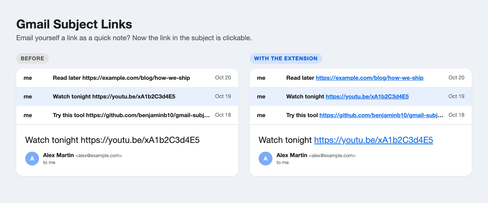

# Gmail Subject Links

A tiny Chrome extension that makes URLs in Gmail subject lines clickable.

*Illustration with made-up emails.*

## Why

A lot of people email themselves quick notes: the whole note goes in the subject, the body stays empty. When the note is a link, Gmail shows it as plain text, so you have to select it, copy it and paste it into a new tab. This extension turns those URLs into real links.

## What it does

- Links URLs (`http://` and `https://`) in the subject of the open email and in the inbox list.
- Opens them in a new tab. In the inbox list, clicking the link opens the link only, not the email.
- Leaves trailing punctuation out of the link (`.`, `,`, `)` and so on).
- Only changes what you see in your own browser. The emails themselves are never modified.

## Privacy

- About 60 lines of plain JavaScript, no dependencies, no build step.
- No permissions besides running on `mail.google.com`.
- No network requests, no storage, no analytics. Nothing leaves your browser.

## Install

1. Download this repo (green **Code** button, **Download ZIP**, then unzip) or `git clone` it.
2. Open `chrome://extensions` and turn on **Developer mode** (top right).
3. Click **Load unpacked** and pick the folder.
4. Reload Gmail.

Works in Chrome and Chromium browsers (Edge, Brave, Arc, Dia).

## Limits

Gmail does not offer an API for its interface, so the extension finds subjects through Gmail's internal CSS classes (`h2.hP` for the open email, `span.bog` for the inbox list). They have been stable for years, but if Gmail renames them, the selector in `content.js` needs an update. Issues and pull requests are welcome.

## License

MIT
